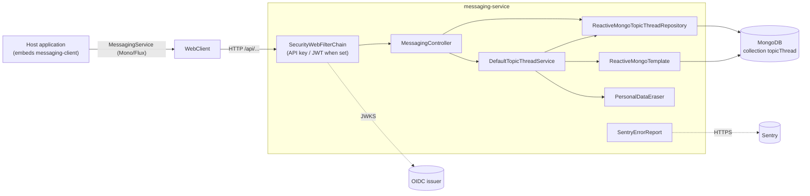

# Messaging System — Architecture

## Purpose and scope

**Does**

- Stores **topic threads** (`TopicThread`: subject, tags, `from`, `to[]`, messages), where each
  message has a body, sender, recipients, `replyToMessageId`, `anonymousSender`, and metadata with
  `sentBy` and the `readBy` set of emails. (`messaging-core/.../domain/*`)
- Serves inbox and outbox search and count by group and email, with a case-insensitive text filter
  over subject, tags and correspondents, plus unread threads per user and groups, read/unread
  marking, and replies. (`messaging-service/.../repository/ReactiveMongoTopicThreadRepository`,
  `controller/MessagingController`)
- Erases a user's personal data across threads (GDPR) through `POST user/anonymize`.
  (`privacy/PersonalDataEraser`, `DefaultTopicThreadService#anonymizeUser`)
- Optionally requires an API key and/or a JWT from callers, and reports errors to Sentry.

**Does not**

- Send emails or notifications. (no mail or JMS dependency)
- Authorise access per user or group. It trusts the `email`/`groupId` parameters supplied by the
  caller. (see [security-model.md](security-model.md)). End-user authorisation is planned for a
  later version.
- Manage users or groups. `groupId` values are opaque strings.

## Technical stack

| Item | Value | Evidence |
|---|---|---|
| Java | 21 | `pom.xml` |
| Framework | Spring Boot 3.5.15 WebFlux (Netty), reactive (`Mono`/`Flux`) | POMs |
| Storage | Spring Data MongoDB Reactive, `auto-index-creation=true` | `messaging-service/pom.xml`, `application.properties` |
| Security | Spring Security WebFlux, optional API key filter, OAuth2 resource server (JWT), stateless | `config/SecurityConfig`, `config/ApiKeyWebFilter` |
| Errors | `SentryErrorReport` (`@ControllerAdvice`), Sentry Spring Boot starter | `config/SentryErrorReport` |
| API docs | springdoc WebFlux UI 2.8.17 (disabled by default) | `config/OpenApiConfig`, `application.properties` |
| Build | Maven wrapper, license-maven-plugin, release plugin, `native-maven-plugin` (image build) | `pom.xml`, `messaging-service/pom.xml` |

## Main modules and responsibilities

| Module | Key types | Responsibility |
|---|---|---|
| `messaging-core` | `domain` (`TopicThread` `@Document`, `StoredMessage`, `Message`, `Metadata`, `Correspondent` with indexed `email`/`groupId`), `dto` (`ThreadDTO`, `UnreadThreads`, `AnonymizeUserRequest`, ...), `controller.TopicThreadsController` (`@RestController` interface with the mappings), `RestApiPaths`, `repository.ReactiveTopicThreadRepository`, `service.ThreadOperations`/`TopicThreadService`, `privacy.PersonalDataEraser` | Contract shared by the service and the client |
| `messaging-service` | `MessagingSystemApplication`, `controller.MessagingController`, `service.DefaultTopicThreadService` (atomic message and read-receipt updates through `ReactiveMongoTemplate`), `service.SearchTerms`, `repository.ReactiveMongoTopicThreadRepository` (`@Query` JSON queries), `config.SecurityConfig`, `ApiKeyWebFilter`, `OpenApiConfig`, `SentryErrorReport` | Deployable reactive service |
| `messaging-client` | `config.MessagingClientConfig` (`@AutoConfiguration`, bean `messagingClient`, `@ConditionalOnMissingBean`), `MessagingClientProperties` (`messaging-system.client.*`), `MessagingWebClients` (WebClient with API key and timeouts), `service.MessagingService` | Client for other Spring Boot apps |

`messaging-client` also contains `controller.MessagingController`, a `TopicThreadsController`
implementation backed by `WebClient`. It isn't registered as a bean by the auto-configuration.

## Component diagram

## Data and state

| Item | Value |
|---|---|
| Collection | `topicThread` (Spring Data default for `@Document class TopicThread`) |
| Message ids | Position of the message in the thread (`"0"`, `"1"`, ...), set by the atomic append |
| Indexes | `@Indexed` fields in `TopicThread` and `Correspondent` (`email`, `groupId`), created automatically (`spring.data.mongodb.auto-index-creation=true`) |
| Database | `spring.data.mongodb.database` (packaged default `messaging-dev`) |
| Schema migrations | None (document store) |

## Security

Optional API key and JWT authentication of the calling application, no per-user authorisation,
search terms matched literally, and CORS and CSRF disabled. See [security-model.md](security-model.md).

## Significant design decisions

- **Reactive stack end-to-end** (WebFlux, reactive Mongo, `WebClient` client).
- **Shared controller interface in core**, so the server and the client implement the same contract.
  The erase endpoint is declared only on the service controller, so it isn't re-exposed by
  consumers. (`MessagingController#anonymizeUser` Javadoc)
- **Atomic thread updates**: a message is appended with one pipeline update that derives its id
  from the current message count, and read receipts change with `$addToSet`/`$pull`, so concurrent
  requests don't overwrite each other. (`DefaultTopicThreadServiceTest`)
- **Anonymise rather than delete** on erasure: conversation shape and third-party text are kept,
  correspondent names and emails are replaced with `[Deleted User]`, and read receipts are removed.
 (`PersonalDataEraser`)
